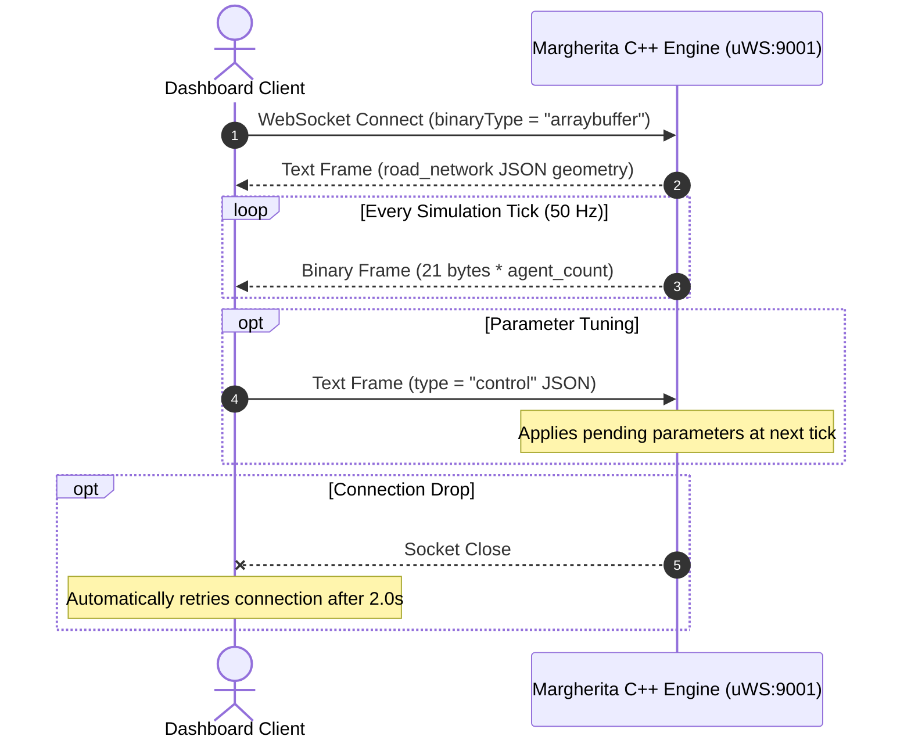

# मार्गerita API and Protocol Reference

## 1. Network API Status

**Margherita** exposes a single network interface: **a high-performance WebSocket protocol** implemented in C++ using `uWebSockets`. It does not expose HTTP REST endpoints, GraphQL, authentication, or database persistence.

The default WebSocket endpoint is:

```text
ws://localhost:9001/
```

The C++ server binds the WebSocket route to `/*`. The port is configured via `ws_port` in `config.default.json` (default `9001`). The primary dashboard connects to `WS_URL` defined in [`dashboard/src/utils/constants.js`](file:///home/rahul/TruTraffic/dashboard/src/utils/constants.js).

---

## 2. Connection Lifecycle



1. **Connection Initiation:** The dashboard opens a WebSocket connection and sets `binaryType = "arraybuffer"`.
2. **Road Geometry Handshake:** Upon connection opening, the engine immediately sends a single JSON text frame containing the complete road graph, junction polygons, barricades, and potholes.
3. **Continuous State Streaming:** On every simulation tick ($dt = 0.02$ s, 50 Hz), the engine broadcasts one packed binary frame to all connected clients.
4. **Interactive Control:** Clients may transmit JSON text frames with `type: "control"` at any time to adjust parameters or toggle hazards.
5. **Reconnection Watchdog:** If the connection drops, the dashboard retries every 2.0 seconds.

---

## 3. Server-to-Client Messages

### 3.1 Road Network Message
* **Transport:** WebSocket Text Frame (UTF-8 JSON)
* **Frequency:** Once, immediately upon socket open

```json
{
  "type": "road_network",
  "edges": [
    {
      "id": "segment_north_0",
      "width": 10.5,
      "centerline": [[0.0, 0.0], [100.0, 0.0]]
    }
  ],
  "junctions": [
    {
      "id": "junc_0",
      "position": [100.0, 0.0],
      "shape": [[95.0, -5.0], [105.0, -5.0], [105.0, 5.0], [95.0, 5.0]]
    }
  ],
  "barricades": [
    {
      "id": "barricade_1",
      "hull": [[40.0, 2.0], [45.0, 2.0], [45.0, 4.0], [40.0, 4.0]]
    }
  ],
  "potholes": [
    {
      "id": "pothole_1",
      "center": [60.0, 1.5],
      "radius": 2.0,
      "severity": 0.5
    }
  ]
}
```

#### Field Specifications

| Object | Field | Type | Description |
|---|---|---|---|
| **Edge** | `id` | `string` | Unique edge identifier. Note: Internal junction connectors (`is_internal = true`) are serialized alongside external segments to provide continuous centerlines through intersections. |
| | `width` | `number` | Road corridor width in meters. |
| | `centerline` | `[[number, number], ...]` | 2D world-plane coordinates $[x, y]$ tracing the segment center. |
| **Junction** | `id` | `string` | Junction/intersection identifier. |
| | `position` | `[number, number]` | World-plane center coordinate $[x, y]$. |
| | `shape` | `[[number, number], ...]` | Convex/concave boundary polygon vertices for rendering. |
| **Barricade**| `id` | `string` | Barricade identifier. |
| | `hull` | `[[number, number], ...]` | Convex 2D polygon vertices for SAT collision resolution. |
| **Pothole** | `id` | `string` | Pothole identifier. |
| | `center` | `[number, number]` | World-plane center coordinate $[x, y]$. |
| | `radius` | `number` | Hazard radius in meters. |
| | `severity` | `number` | Hazard factor ($0.0 - 1.0$), scaling speed attenuation. |

---

### 3.2 Agent State Frame
* **Transport:** WebSocket Binary Frame
* **Frequency:** 50 Hz (every interactive simulation tick)
* **Frame Size:** Exactly $21 \times N$ bytes, where $N$ is the active agent count
* **Byte Order:** Little-endian

Each 21-byte record represents one simulated traffic participant:

```text
 0      4 5         9        13        17        21
┌────────┬┬─────────┬─────────┬─────────┬─────────┐
│ AgentID│T│ Pos X   │ Pos Y   │ Heading │ Speed   │
│ uint32 │u│ float32 │ float32 │ float32 │ float32 │
└────────┴┴─────────┴─────────┴─────────┴─────────┘
 (Bytes)  1
```

| Byte Offset | Size | Data Type | Encoding | Field Description |
|---:|---:|---|---|---|
| `0` | 4 bytes | `int32_t` / `uint32` | 32-bit integer | Unique Agent ID. Transmitted via `memcpy` from C++ `int id`. |
| `4` | 1 byte | `uint8` | 8-bit enum | Vehicle / Agent Class (enumerated below). |
| `5` | 4 bytes | IEEE 754 `float32` | 32-bit float | X coordinate in meters (world road plane). |
| `9` | 4 bytes | IEEE 754 `float32` | 32-bit float | Y coordinate in meters (world road plane). |
| `13` | 4 bytes | IEEE 754 `float32` | 32-bit float | Heading angle in radians ($-\pi$ to $+\pi$). |
| `17` | 4 bytes | IEEE 754 `float32` | 32-bit float | Velocity magnitude in meters/second. |

#### Agent Class Mapping (`type`)

| Numeric Value | Class Name | Typical Dimensions (W × L) |
|:---:|---|:---:|
| `0` | Two-wheeler (Motorcycle / Scooter) | $0.7\text{m} \times 1.8\text{m}$ |
| `1` | Auto-rickshaw (Three-wheeler) | $1.3\text{m} \times 2.6\text{m}$ |
| `2` | Passenger Car | $1.8\text{m} \times 4.2\text{m}$ |
| `3` | Transit Bus | $2.5\text{m} \times 10.5\text{m}$ |
| `4` | Pedestrian | $0.5\text{m} \times 0.5\text{m}$ |
| `5` | Bicycle | $0.65\text{m} \times 1.65\text{m}$ |
| `6` | Heavy Commercial Truck | $2.5\text{m} \times 8.8\text{m}$ |
| `7` | Medium Commercial Vehicle | $1.8\text{m} \times 3.6\text{m}$ |

---

## 4. Client-to-Server Messages

### 4.1 Control Message
* **Transport:** WebSocket Text Frame (JSON)
* **Frequency:** On-demand (when user interacts with dashboard controls)

```json
{
  "type": "control",
  "num_agents": 250,
  "idm_T": 1.4,
  "sfm_A": 4.5,
  "barricades_enabled": true,
  "potholes_enabled": false
}
```

#### Supported Control Fields

| Field | Type | Constraint | C++ Engine Effect |
|---|---|---|---|
| `num_agents` | `integer` | $> 0$ | Dynamically adjusts the free-running fleet size. Spawns new agents if count is increased; shrinks state vectors if decreased. |
| `idm_T` | `number` | $> 0.0$ | Updates the IDM desired time headway (seconds) for subsequent physics steps. |
| `sfm_A` | `number` | $> 0.0$ | Updates the Social Force repulsive force magnitude (N) for subsequent physics steps. |
| `barricades_enabled` | `boolean` | `true` / `false` | Enables or disables physical barricade SAT collision detection. |
| `potholes_enabled` | `boolean` | `true` / `false` | Enables or disables pothole acceleration dampening. |

> [!NOTE]
> In the primary dashboard ([`SimControls.jsx`](file:///home/rahul/TruTraffic/dashboard/src/components/SimControls.jsx)), the user-facing controls include `num_agents`, `idm_T`, `speed_multiplier`, `barricades_enabled`, and `potholes_enabled`. The `sfm_A` slider is available in the secondary prototype dashboard ([`indian-traffic-sim/dashboard`](file:///home/rahul/TruTraffic/indian-traffic-sim/dashboard)).

### 4.2 Browser-Only Simulator Fields
The dashboard also manages fields handled exclusively by the client-side simulator ([`CustomRoadSimulator.js`](file:///home/rahul/TruTraffic/dashboard/src/utils/customRoadSimulator.js)):
* `speed_multiplier`: Scales agent movement in the browser between $0.5\text{x}$ and $2.5\text{x}$. Ignored by the C++ engine.
* `reset`: Resets client-side agents. Ignored by the C++ engine.

---

## 5. Local File Upload Contract (Browser Importer)

The dashboard allows importing custom road corridors directly via the **Map > Import & Upload** dialog:

### Supported Formats
1. **Normalized Road Network JSON:**
   Must contain a non-empty `edges` array where each edge specifies `id`, `width`, and a `centerline` with at least two $[x, y]$ points.
2. **GeoJSON `FeatureCollection`:**
   Features with `LineString` or `MultiLineString` geometry are converted to road centerlines. `properties.width` is extracted if present (defaults to $12.0$ m).

> [!CAUTION]
> Raw OSM/XML files cannot be parsed directly in the browser. Use the offline map toolchain (`extract_map.py`) to convert OpenStreetMap extracts into SUMO networks.

---

## 6. Engine Command-Line Interface (CLI)

The `traffic_sim` executable supports the following CLI options:

```bash
traffic_sim [config_path] [options]
```

```text
Options:
  --headless                Run simulation without WebSocket streaming.
  --duration <seconds>      Simulated time cutoff for headless mode before output.
  --num_agents <count>      Override free-running fleet population.
  --idm_T <seconds>         Override IDM time headway.
  --idm_s0 <meters>         Override IDM minimum jam distance.
  --sfm_A <value>           Override Social Force repulsive magnitude.
  --sfm_B <value>           Override Social Force interaction range.
  --comf_decel <value>      Override comfortable deceleration limit.
  --car_width <meters>      Override passenger car profile width.
  --car_length <meters>     Override passenger car profile length.
  --schedule <json_path>    Load inflow schedule for benchmark validation.
  --net_xml <xml_path>      Override SUMO network XML path (use "" for test corridor).
```

> [!IMPORTANT]
> The engine uses `--net_xml <path>` to specify a SUMO network file. `--map` is not a valid argument.

---

## 7. Headless Output API

When `--headless` and `--duration <seconds>` are specified, the engine terminates upon reaching the target duration and outputs a single JSON object to `stdout`:

### Free-Running Mode Output
```json
{
  "flow": 14.82,
  "avg_gap": 9.15,
  "gaps_timeseries": [8.4, 8.8, 9.1, 9.3],
  "deadlocked_percent": 1.5,
  "deadlocked_count": 3
}
```
* `flow`: Estimated corridor flow rate (vehicles/minute), calculated via hydrodynamic relation $q = K \cdot \bar{V} \cdot 60$.
* `avg_gap`: Average gap (meters) to the leader directly ahead across all agents.
* `gaps_timeseries`: Time series of mean forward gaps sampled at **10 Hz** (every 5 simulation ticks).
* `deadlocked_percent`: Percentage of fleet with velocity $< 0.1$ m/s at completion.
* `deadlocked_count`: Absolute count of vehicles with velocity $< 0.1$ m/s at completion.

### Scheduled Trajectory Mode Output (Phase 8 Multi-Objective Calibration)
When `--schedule <json_path>` is provided:

```json
{
  "congestion_failures": 1,
  "trajectories": {
    "42": {
      "speed": [8.12, 8.35, 8.41],
      "tan_acc": [0.23, 0.08, -0.12],
      "lat_acc": [0.01, -0.04, 0.02]
    }
  }
}
```
* `congestion_failures`: Number of scheduled spawn events that experienced an initial collision overlap at entry.
* `trajectories`: Dictionary keyed by empirical vehicle track ID. Each profile contains arrays sampled at **1 Hz**:
  * `speed`: Longitudinal speed profile (m/s).
  * `tan_acc`: Tangential (longitudinal) acceleration (m/s²).
  * `lat_acc`: Lateral acceleration perpendicular to heading (m/s²).

---

## 8. Offline Toolchain Commands

All offline utilities should be executed from the `indian-traffic-sim/` directory:

```bash
# Extract real-world OpenStreetMap corridor into a SUMO network
cd indian-traffic-sim
./change_map.sh "Connaught Place, New Delhi, India" 500

# Run multi-objective Genetic Algorithm calibration
python scripts/calibrate/ga_optimizer.py

# Validate parameters against empirical dataset DEL_4.csv
python scripts/calibrate/validate_del4.py
```
