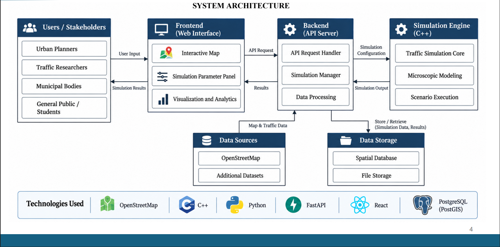
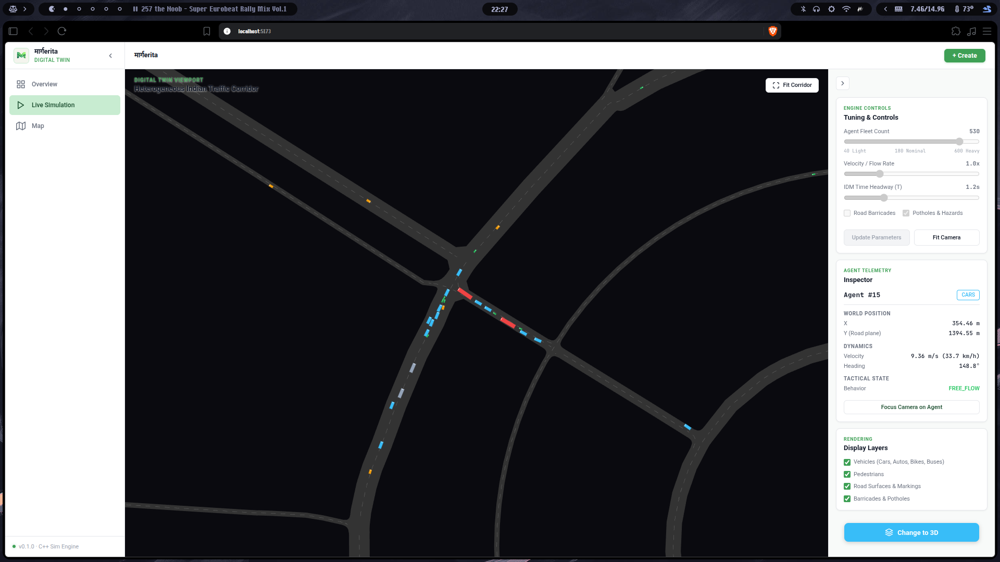
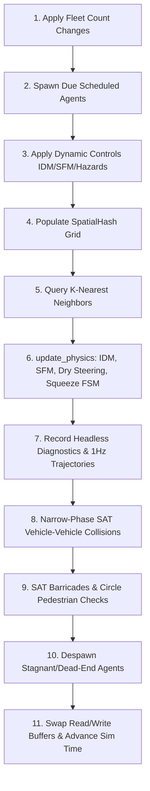
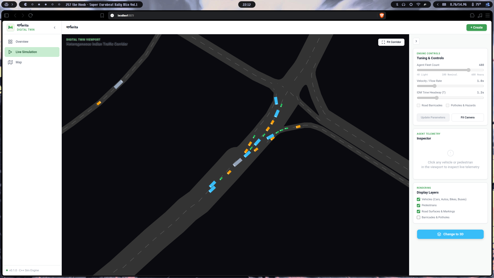
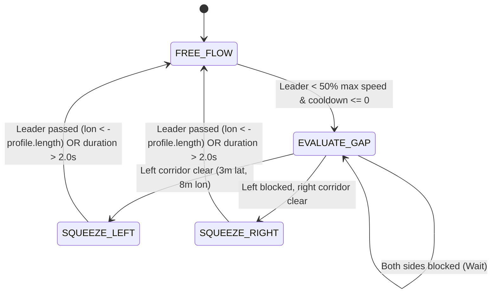
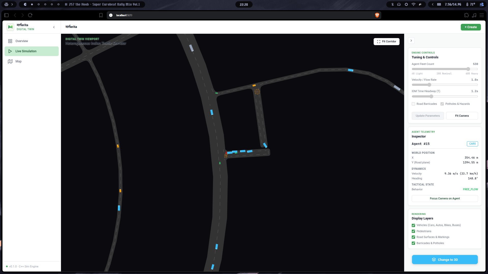

# मार्गerita System Documentation

## 1. Purpose and Scope

**Margherita** (stylized as **मार्गerita**, combining the Sanskrit/Hindi root *मार्ग* [path/road] with *erita*) models a heterogeneous, lane-less traffic corridor as a live digital twin. Its primary goal is to simulate and expose the non-lane-based physics and negotiation dynamics characteristic of Indian urban corridors—including lateral squeezing, mixed vehicle classes (bicycles to multi-axle buses), pedestrian interactions, dynamic hazard avoidance, and stochastic corridor selection.

The Margherita platform serves two complementary functions:
1. **Interactive Digital Twin Exploration:** Real-time 50 Hz visualization across dual **3D WebGL** and **2D Canvas** viewports with runtime tuning of traffic density, time headway, and hazard injection.
2. **Deterministic-ish Headless Trajectory Calibration:** Rapid headless execution for Multi-Objective Genetic Algorithm (GA) calibration against empirical real-world GPS and drone trajectory datasets.



---

## 2. System Boundaries and Architecture

### Included in the Core System
* **C++20 Microscopic Simulation Core:** Deterministic state propagation, double-buffered state vectors, and spatial hashing.
* **SUMO Road Network Ingestion:** Comprehensive parsing of SUMO `.net.xml` networks, including junctions, multi-lane widths, and internal transition connections (`is_internal`).
* **Heterogeneous Physics Engine:**
  * Longitudinal car-following via width-overlap-weighted Intelligent Driver Model (IDM).
  * Lateral continuous negotiation via Social Force Model (SFM) with asymmetric passing clearance.
  * Tactical Finite State Machine (FSM) managing proactive gap evaluation, squeeze duration timers, and lateral offset tracking.
  * Low-speed "dry steering" heading correction for stopped or creeping vehicles.
  * Narrow-phase collision handling via Separating Axis Theorem (SAT) convex polygon tests and circle-polygon pedestrian tests.
* **Stochastic Routing Engine:** Gumbel-distributed route assignment with logit scale $\theta$, congestion density penalties $\lambda$, and pre-computed noise allocation.
* **WebSocket Server:** High-performance binary streaming over uWebSockets on port 9001 (by default).
* **Dual-Renderer React 19 Dashboard:**
  * 3D WebGL renderer ([`SimulationCanvas.jsx`](file:///home/rahul/TruTraffic/dashboard/src/components/SimulationCanvas.jsx)) using Three.js instanced meshes.
  * 2D Canvas renderer ([`SimulationCanvas2D.jsx`](file:///home/rahul/TruTraffic/dashboard/src/components/SimulationCanvas2D.jsx)) using HTML5 Canvas with mouse pan/zoom.
  * Runtime engine parameter controls, real-time telemetry inspector, and corridor layer toggles.
* **Map Extraction Toolchain:** Automated OpenStreetMap retrieval via OSMnx and `netconvert` compilation.
* **Multi-Objective Calibration Suite:** Genetic algorithm optimization matching simulated trajectories against empirical speed and acceleration profiles.

### Architectural Boundaries & Non-Goals
* No HTTP REST or GraphQL endpoints; all live communication utilizes WebSocket frames.
* No server-side relational database, authentication, or persistent multi-tenant state.
* Client-side uploaded road networks run on a browser-local path-following simulator (`CustomRoadSimulator`) rather than dynamically swapping the C++ engine's network graph.

---

## 3. Runtime Engine Components

### 3.1 Entry Point and CLI Parsing
The engine entry point is located in [`main.cpp`](file:///home/rahul/TruTraffic/indian-traffic-sim/engine/src/main.cpp). On startup, it:
1. Registers POSIX signal handlers (`SIGINT`, `SIGTERM`) for graceful shutdown.
2. Parses CLI flags and overrides.
3. Loads baseline parameters from the specified JSON file via `load_config()`.
4. Applies command-line overrides for all non-negative or non-empty flags.
5. Instantiates the `Engine` and enters the primary execution loop via `engine.run()`.

> [!IMPORTANT]
> The positional argument is interpreted as the configuration file path. If omitted, the default is `../config/config.default.json` relative to the process working directory. When executing from `indian-traffic-sim/engine/build`, pass `../../config/config.default.json` explicitly.

### 3.2 Configuration Parameter Model
Simulation configuration is encapsulated in [`SimConfig`](file:///home/rahul/TruTraffic/indian-traffic-sim/engine/src/core/SimConfig.h). Parameters originate from three distinct tiers:

| Parameter Category | Field Name | Loaded via JSON (`load_config`) | Settable via CLI | Runtime WebSocket Control | Default Value | Description |
|---|---|:---:|:---:|:---:|:---:|---|
| **Time & World** | `dt` | Yes | No | No | `0.02` s | Physics integration time step (50 Hz). |
| | `target_fps` | Yes | No | No | `50` | Nominal interactive frame cadence. |
| | `world_width`, `world_height` | Yes | No | No | `1000.0` m | Boundary dimensions for fallback test grids. |
| **Fleet Population** | `num_agents` | Yes | `--num_agents` | `num_agents` | `200` | Target free-running fleet count. |
| | `vehicle_distribution` | Yes | No | No | *See note* | Probabilities across the 8 vehicle classes. |
| | `min_route_segments` | Yes | No | No | `5` | Minimum edge length for random routes. |
| **Spatial Indexing** | `K_neighbors` | Yes | No | No | `16` | Maximum nearest neighbors queried per agent. |
| | `grid_cell_size` | Yes | No | No | `10.0` m | Spatial hash grid bucket dimension. |
| | `max_step_ms` | Yes | No | No | `12.0` ms | Latency warning budget per simulation step. |
| **Longitudinal (IDM)** | `idm_s0` | Yes | `--idm_s0` | No | `2.0` m | Minimum net jam distance. |
| | `idm_T` | Yes | `--idm_T` | `idm_T` | `1.5` s | Desired time headway. |
| | `idm_a` | Yes | No | No | `2.5` m/s² | Maximum desired longitudinal acceleration. |
| | `idm_b` | Yes | No | No | `4.0` m/s² | Comfortable deceleration. |
| | `idm_delta` | Yes | No | No | `4.0` | Acceleration exponent. |
| **Lateral (SFM)** | `sfm_A` | Yes | `--sfm_A` | `sfm_A` | `5.0` N | Social force repulsive magnitude. |
| | `sfm_B` | Yes | `--sfm_B` | No | `0.3` m | Interaction distance decay parameter. |
| | `sfm_goal_weight` | Yes | No | No | `1.0` | Forward corridor alignment weight. |
| | `sfm_asymmetric_weight`| Yes | No | No | `0.5` | Opposing-traffic clearing weight. |
| | `sfm_tau` | Yes | No | No | `0.5` s | Relaxation time constant. |
| | `lateral_spread_sigma` | Yes | No | No | `0.4` | Proactive lateral noise magnitude. |
| **Tactical FSM** | `fsm_squeeze_speed_factor` | Yes | No | No | `0.7` | Speed multiplier during squeeze state. |
| | `fsm_yield_distance` | Yes | No | No | `15.0` m | Reserved for yield evaluation. |
| | `fsm_turn_max_speed` | Yes | No | No | `5.0` m/s | Upper velocity limit during sharp turns. |
| **Stochastic Routing** | `route_logit_theta` | Yes | No | No | `0.15` | Gumbel noise scale (Logit temperature). |
| | `route_density_lambda` | Yes | No | No | `0.0` | Congestion density avoidance penalty weight. |
| **Network & Hazards** | `net_xml_path` | Yes | `--net_xml` | No | `""` | Path to SUMO `.net.xml` road network. |
| | `obstacles_json_path` | Yes | No | No | `""` | Path to static barricades/potholes JSON. |
| | `enable_barricades` | **No** | No | `barricades_enabled`| `true` | Physical barricade collision switch. |
| | `enable_potholes` | **No** | No | `potholes_enabled` | `true` | Pothole acceleration dampening switch. |
| **Execution Mode** | `headless` | **No** | `--headless` | No | `false` | Headless execution flag (no WebSocket). |
| | `duration` | **No** | `--duration` | No | `-1.0` s | Simulated duration cutoff in headless mode. |
| | `schedule_json_path` | **No** | `--schedule` | No | `""` | Inflow schedule JSON for benchmark runs. |
| **Profile Overrides** | `comf_decel` | **No** | `--comf_decel`| No | `-1.0` m/s² | Global override for comfortable decel. |
| | `car_width`, `car_length` | **No** | `--car_width/length` | No | `-1.0` m | Global dimensions override for passenger cars. |
| **Network Listener** | `ws_port` | Yes | No | No | `9001` | TCP port for uWebSockets broadcast. |

> [!NOTE]
> **Vehicle Distribution Fallback:** If `config.default.json` is missing, `SimConfig.h` provides a compiled 4-class fallback (`{0.40, 0.15, 0.35, 0.10}` covering two-wheelers, auto-rickshaws, cars, and buses). In normal operation, `config.default.json` loads the calibrated 8-class empirical distribution.

---

### 3.3 Network Ingestion and Geometry Construction



#### 1. SUMO XML Parsing (`NetXmlParser.cpp`)
SUMO `.net.xml` files are parsed via `pugixml` into intermediate structs:
* **`NetEdge`:** Edge ID, junction endpoints, lane count, lane widths, speed limits, shape coordinates, and `is_internal` status.
* **`NetJunction`:** Junction ID, center coordinate, type (`traffic_light`, `priority`, etc.), and 2D boundary polygon.
* **`NetConnection`:** Legal lane-to-lane turning transitions linking source edges to target edges via internal junction connectors.

#### 2. Internal Road Graph Construction (`RoadGraph.cpp`)
`RoadGraph::build_from_net_map` maps network geometry into uniform `RoadSegment` instances.
* **Continuous Junction Centerlines (Phase 10):** Internal junction connector edges (`is_internal = true`) are fully preserved and indexed in the graph. Connections explicitly bind incoming corridors through junction curves to outgoing roads (`From -> Internal Connector -> To`).
* **Hard Boundary Enforcement:** Vehicles calculate their lateral displacement relative to the segment's continuous centerline. A strict clamping bound ensures vehicle positions snap flush with road boundaries:
  $$\text{max\_offset} = \max\left(0, \frac{\text{width}}{2} - \frac{\text{profile.width}}{2} - 0.3\right)$$
  Continuous internal geometry prevents off-road drifting at complex intersections.

#### 3. Stochastic Route Choice (Phase 9)
Route selection utilizes a Gumbel-based Logit Stochastic Dijkstra algorithm:
* **Independence of Irrelevant Alternatives (IIA):** To prevent Dijkstra's queue exploration order from distorting edge costs across different parts of the network, Gumbel noise perturbations are **pre-computed once across all graph edges** before the priority queue search begins.
* **Deterministic Thread-Safe Seeding:** Random noise is seeded using simulation state variables:
  $$\text{seed} = (\text{agent\_id} \times 2654435761) \oplus (\text{start\_seg} \times 14695981039346656037) \oplus (\text{end\_seg} \times 1099511628211)$$
* **Congestion Rerouting:** An optional density penalty $\lambda$ scales link costs based on real-time segment vehicle counts.

---

### 3.4 Agent Representation and Heterogeneous Fleets

Agents are represented by [`AgentState`](file:///home/rahul/TruTraffic/indian-traffic-sim/engine/src/core/AgentTypes.h) structures. The simulation models eight discrete modes:

| ID | Vehicle Class | Width (m) | Length (m) | Max Speed (m/s) | Accel (m/s²) | Decel (m/s²) | Hull Geometry |
|:---:|---|:---:|:---:|:---:|:---:|:---:|---|
| **0** | Two-wheeler | 0.70 | 1.80 | 15.0 | 3.5 | 6.0 | 4-point rectangle |
| **1** | Auto-rickshaw | 1.30 | 2.60 | 11.1 | 2.0 | 4.5 | 5-point tapered wedge |
| **2** | Passenger Car | 1.80 | 4.20 | 16.7 | 2.5 | 5.0 | 4-point rectangle |
| **3** | Transit Bus | 2.50 | 10.50 | 11.1 | 1.2 | 3.5 | 4-point rectangle |
| **4** | Pedestrian | 0.50 | 0.50 | 1.5 | 1.0 | 2.0 | Circle approximation |
| **5** | Bicycle | 0.65 | 1.65 | 5.5 | 1.5 | 3.0 | 4-point rectangle |
| **6** | Heavy Commercial Truck| 2.50 | 8.80 | 11.1 | 1.0 | 3.0 | 4-point rectangle |
| **7** | Medium Commercial Veh | 1.80 | 3.60 | 13.9 | 1.8 | 4.0 | 4-point rectangle |

Each agent maintains randomized capabilities around profile baselines ($\pm 20\%$), steering angle, 5-point collision hull, waypoint indexing, lateral offset, longitudinal acceleration (`current_tan_acc`), lateral acceleration (`current_lat_acc`), and tactical state.

---

### 3.5 Simulation Tick Lifecycle

Every simulation cycle ($dt = 0.02$ s, 50 Hz), [`Engine::tick()`](file:///home/rahul/TruTraffic/indian-traffic-sim/engine/src/core/Engine.cpp#L203) executes the following sequence:



1. **Fleet Population Balancing:** Adjusts free-simulation population to match `num_agents`.
2. **Inflow Schedule Spawning:** Spawns scheduled trajectory agents at their exact entry coordinates and computes route paths.
3. **Control Application:** Atomic exchange of pending WebSocket controls (`num_agents`, `idm_T`, `sfm_A`, barricade/pothole toggles).
4. **Broad-Phase Indexing:** Re-indexes agent 2D positions into the spatial hash grid ($10\text{m} \times 10\text{m}$ cells).
5. **Neighbor Retrieval:** Queries up to $K=16$ nearest neighbors within interaction radius.
6. **Physics Integration (`update_physics`):**
   * Computes longitudinal IDM acceleration adjusted for lateral leader overlap ($\omega$).
   * Computes lateral SFM repulsive forces from surrounding neighbors.
   * Updates tactical state machine (gap evaluation and squeeze initiation).
   * Executes low-speed dry steering and bicycle-model kinematic integration.
7. **Diagnostics & Trajectory Sampling:**
   * In scheduled headless mode: Samples 1 Hz speed, tangential acceleration, and lateral acceleration.
   * In free headless mode: Samples 10 Hz forward gap aggregates.
8. **Narrow-Phase SAT Vehicle Collisions:** Tests oriented polygon hulls via the Separating Axis Theorem (SAT). Applies elastic separation and speed dampening.
9. **Obstacle & Pedestrian Checks:** Resolves vehicle-barricade polygon collisions and vehicle-pedestrian circle-polygon interactions.
10. **Despawn Cleanup:** Erases dead-end agents (`hull_size == 0`) from both read and write state buffers.
11. **Buffer Swap:** Swaps double buffers (`state_read_` $\leftrightarrow$ `state_write_`) and advances `sim_time_` by `dt`.

---

### 3.6 Tactical Behavior and Squeeze Maneuvers



Indian traffic participants actively exploit lateral road capacity without formal lane demarcation. This is modeled in [`FSM.cpp`](file:///home/rahul/TruTraffic/indian-traffic-sim/engine/src/tactics/FSM.cpp) and [`Physics.cpp`](file:///home/rahul/TruTraffic/indian-traffic-sim/engine/src/physics/Physics.cpp):



#### Key Squeeze Mechanisms
1. **Trigger Condition:** When stuck behind a leader moving slower than the ego agent while forced below 50% of desired speed (`ego.speed < 0.5 * profile.max_speed`), the agent enters `EVALUATE_GAP`.
2. **Clearance Window:** The agent verifies that lateral corridors ($-0.5\text{m}$ to $-3.0\text{m}$ on left, $+0.5\text{m}$ to $+3.0\text{m}$ on right) are free of conflicting vehicles. If blocked on both sides, the vehicle waits in `EVALUATE_GAP` without oscillating.
3. **Decoupled Squeeze Duration:** Squeeze states track `squeeze_duration`. The maneuver terminates cleanly when:
   * The slow vehicle is physically behind the ego vehicle: $\text{lon} < -\text{profile.length}$, OR
   * A safety timeout elapses: $\text{squeeze\_duration} > 2.0\text{ s}$.
   * Once finished, `squeeze_cooldown = 0.5\text{ s}` prevents immediate thrashing.
4. **Width-Scaled Force & Offset Tracking:** Lateral force scales with vehicle width:
   $$F_{\text{squeeze}} = 2.0 \times \left(\frac{\text{profile.width}}{1.8}\right)$$
   Crucially, `next.lateral_offset` is dynamically updated during the maneuver, ensuring the road boundary clamp recognizes the displaced position as valid rather than fighting the overtake.
5. **Low-Speed Dry Steering:** Below $0.1$ m/s, vehicles apply a bounded wheel-turn heading rate:
   $$\Delta \theta = \text{clamp}(\text{heading\_delta}, -\text{max\_steer}, \text{max\_steer}) \times 0.3 \times dt$$
   This simulates power steering at near-standstill, preventing vehicles from becoming permanently trapped at sharp angles.

---

### 3.7 Obstacles and Road Hazards



Margherita supports dynamic and static infrastructure hazards:
* **Construction Barricades:** Represented as convex 2D hulls. Vehicles query barricades within $8.0$ m and experience strong SFM repulsion forces capped at $20.0$ N. If contact occurs, SAT collision applies direct penetration displacement and $70\%$ velocity reduction.
* **Potholes & Road Deformities:** Represented as circular regions with center, radius, and a severity factor ($0.0 - 1.0$). Vehicles traversing potholes suffer direct acceleration attenuation and up to $50\%$ target speed reduction.
* **Procedural Synthesis:** If no obstacle dataset is supplied, the C++ engine generates realistic randomized hazards along corridor edges.

---

## 4. Dashboard Architecture and Operation

The user interface lives in [`dashboard/`](file:///home/rahul/TruTraffic/dashboard) and is built on React 19, Vite, and Three.js.

### 4.1 Dual Rendering Modes (3D WebGL vs 2D Canvas)
The live simulation viewport can be toggled instantaneously via the green **Change to 2D** / **Change to 3D** button in the lower right rail:

| Mode | Component | Engine / Technology | Characteristics |
|---|---|---|---|
| **3D WebGL** | [`SimulationCanvas.jsx`](file:///home/rahul/TruTraffic/dashboard/src/components/SimulationCanvas.jsx) | Three.js (r186) | Perspective camera, OrbitControls, dynamic road surface geometry, 3D extruded vehicle hulls, headlight markers, shadow approximations, and raycaster vehicle picking. |
| **2D Top-Down** | [`SimulationCanvas2D.jsx`](file:///home/rahul/TruTraffic/dashboard/src/components/SimulationCanvas2D.jsx) | HTML5 Canvas API | High-performance top-down 2D orthographic canvas, inverted Y-transform matching C++ world coordinates, smooth position/heading interpolation, mouse drag panning, and cursor-centered wheel zooming. |

### 4.2 Dashboard Views and Navigation
1. **Overview Page ([`Overview.jsx`](file:///home/rahul/TruTraffic/dashboard/src/pages/Overview.jsx)):** Real-time macroscopic diagnostic metrics including active agent count, average corridor velocity, FPS, road network segments, modal split pie chart, and hazard inventory.
2. **Live Simulation Page ([`LiveSimulation.jsx`](file:///home/rahul/TruTraffic/dashboard/src/pages/LiveSimulation.jsx)):**
   * Primary viewport with 3D/2D toggle.
   * **SimControls:** Real-time sliders for Agent Fleet Count ($40 - 600$), Velocity Multiplier ($0.5\text{x} - 2.5\text{x}$), IDM Headway $T$ ($0.5\text{s} - 2.5\text{s}$), Barricade toggle, and Pothole toggle.
   * **Agent Inspector:** Detailed telemetry card showing ID, vehicle class badge, $(X, Y)$ world coordinates, velocity (m/s and km/h), heading angle, and tactical FSM state with camera tracking.
   * **Display Layers:** Checkboxes to toggle vehicles, pedestrians, road surfaces/markings, and hazards.
3. **Map Page ([`MapPage.jsx`](file:///home/rahul/TruTraffic/dashboard/src/pages/MapPage.jsx)):** Visual road topology inspection, segment tables, and the custom GeoJSON/JSON road import modal.

### 4.3 Browser CustomRoadSimulator
When a custom road network is uploaded via the dashboard, `App.jsx` activates [`CustomRoadSimulator.js`](file:///home/rahul/TruTraffic/dashboard/src/utils/customRoadSimulator.js). This allows instant client-side visualization of uploaded corridors using tangent-following kinematics without modifying the C++ backend's active network.

---

## 5. Map Pipeline Toolchain

The offline map preparation pipeline lives in [`indian-traffic-sim/map_pipeline/`](file:///home/rahul/TruTraffic/indian-traffic-sim/map_pipeline):

```bash
cd indian-traffic-sim
./change_map.sh "Connaught Place, New Delhi, India" 500
```

1. **Extraction (`extract_map.py`):** Uses OSMnx to query OpenStreetMap for drivable road graphs within the specified bounding radius, outputs a `temp.osm` XML file.
2. **Conversion (`netconvert`):** Executes SUMO's `netconvert` utility with junction joining, internal connection building, and custom road-width mappings (10.5 m for trunks, 5.5 m for residential).
3. **Configuration Auto-Update:** Writes output to `map_output/network.net.xml` and updates `config/config.default.json` with the new absolute path.

---

## 6. Model Calibration and Validation

The calibration framework lives in [`indian-traffic-sim/scripts/calibrate/`](file:///home/rahul/TruTraffic/indian-traffic-sim/scripts/calibrate):

1. **Ground Truth Extraction (`parse_ground_truth.py`):** Converts empirical drone trajectory CSVs (e.g. `DEL_4.csv`) into:
   * `inflow_schedule.json`: Spatially and temporally synchronized vehicle entry events.
   * `target_trajectories.json`: Benchmark speed and acceleration profiles.
2. **Genetic Algorithm Optimization (`ga_optimizer.py`):** Uses differential evolution across five parameters:
   $$\vec{P} = [idm\_T, idm\_s0, comf\_decel, sfm\_A, sfm\_B]$$
   The multi-objective loss function minimizes:
   $$\mathcal{L} = w_1 \cdot \text{DTW}(v_{\text{sim}}, v_{\text{emp}}) + w_2 \cdot \text{MSE}(a^{\text{tan}}_{\text{sim}}, a^{\text{tan}}_{\text{emp}}) + w_3 \cdot \text{MSE}(a^{\text{lat}}_{\text{sim}}, a^{\text{lat}}_{\text{emp}})$$
3. **Validation (`validate_del4.py`):** Evaluates calibrated parameters on independent holdout trajectories, generating formal convergence and MSE reports.

---

## 7. Build, Test, and Operational Checks

### Linux Environment Commands
```bash
# 1. Compile engine and execute CTest suite
cd indian-traffic-sim
./build.sh

# 2. Launch engine in interactive streaming mode
./engine/build/traffic_sim config/config.default.json

# 3. Launch dashboard in development mode
cd ../dashboard
npm install
npm run dev
```

### Verification Suite
The test runner executes GoogleTest suites covering:
* 2D Vector math operations (`Vec2Test`).
* Convex hull construction (`AgentTest`).
* Spatial hash insertion and neighbor bounds (`SpatialHashTest`).
* SAT convex polygon collision detection (`CollisionTest`).
* Tactical FSM transition rules (`FSMTest`).
* Gumbel stochastic routing path generation (`RoadGraphTest`).
* Pothole velocity attenuation (`PhysicsTest`).
