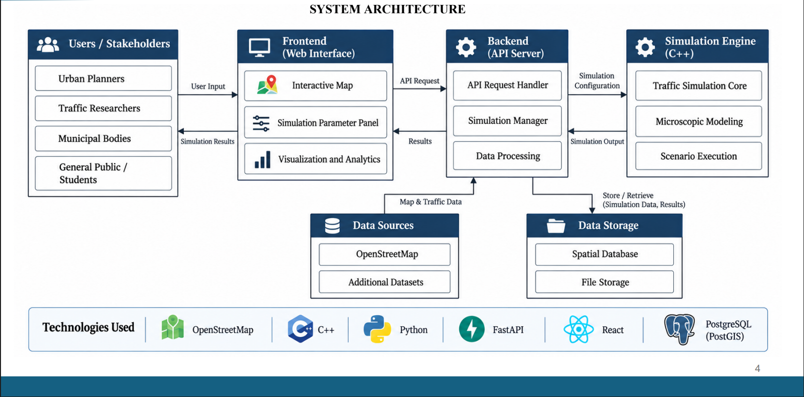
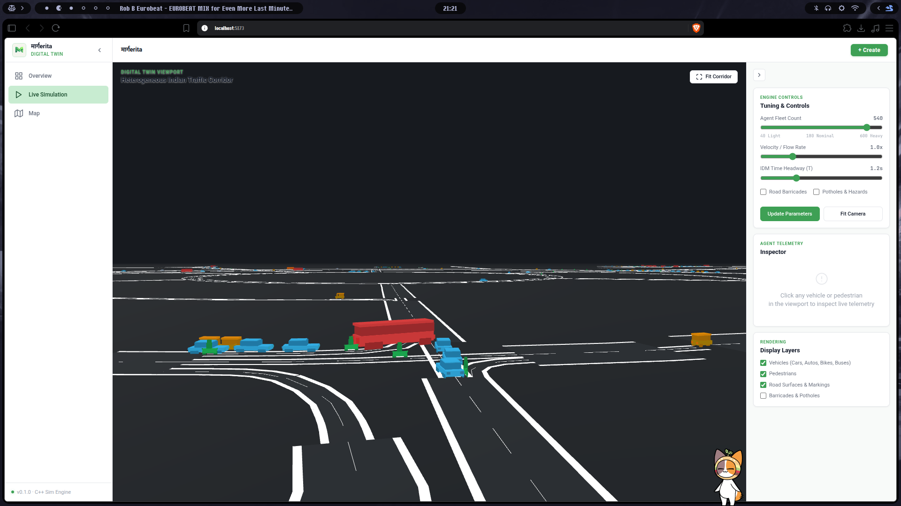
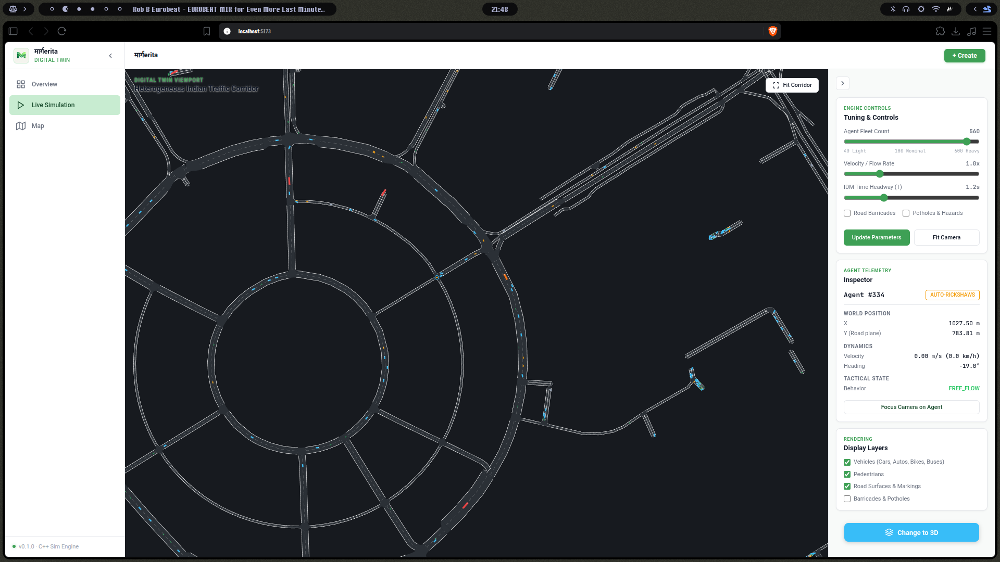
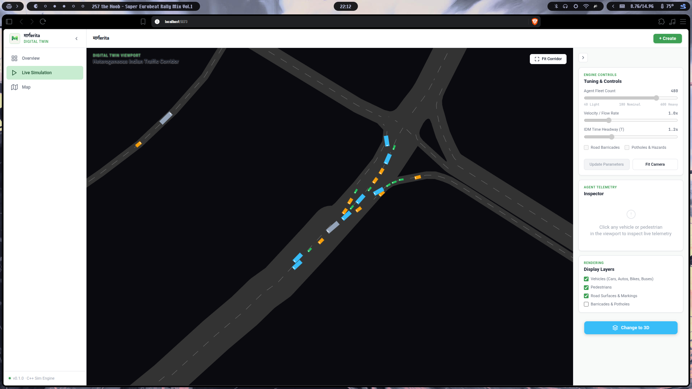
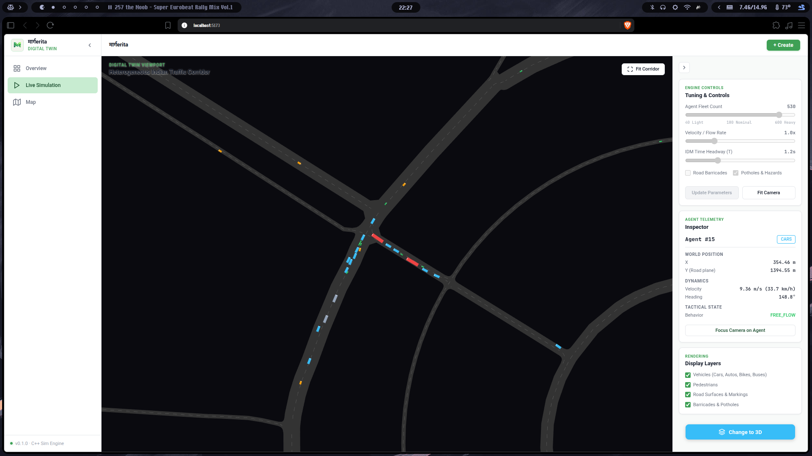
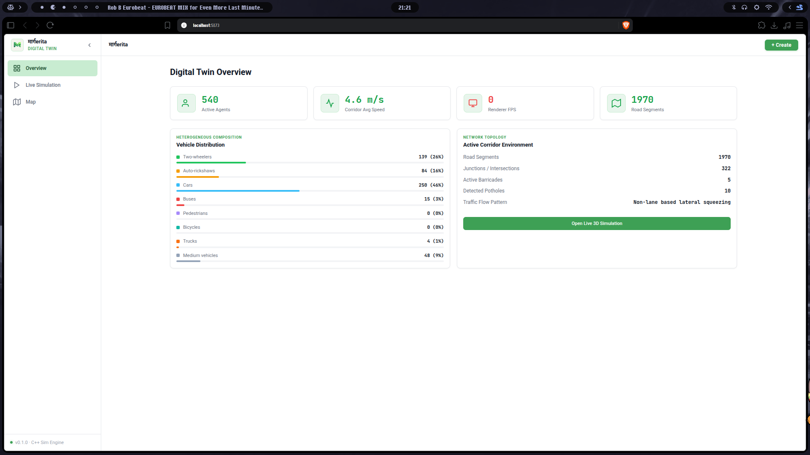
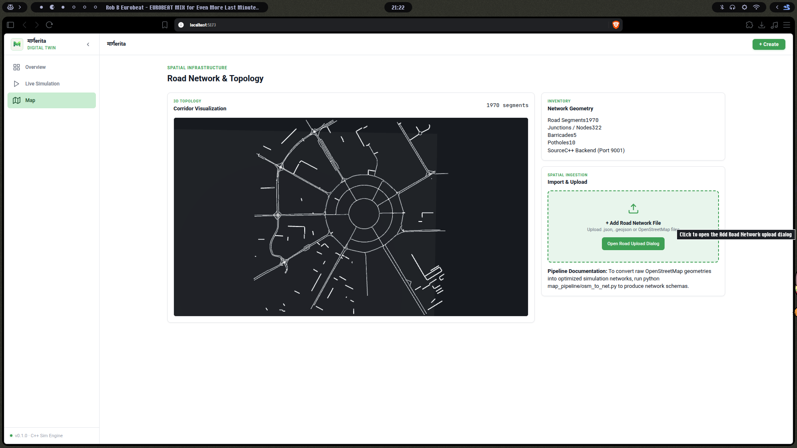

# मार्गerita

[](https://en.wikipedia.org/wiki/C%2B%2B20)
[](https://react.dev/)
[](https://threejs.org/)
[](LICENSE)

**Margherita** (stylized as **मार्गerita**, combining the Sanskrit/Hindi word *मार्ग* for path/road with *erita*) is an interactive, high-performance digital twin and microscopic traffic simulation engine specifically designed for **heterogeneous, lane-less Indian traffic**. 

It pairs an ultra-fast, multi-threaded C++20 simulation core with a modern React dashboard supporting both **3D WebGL (Three.js)** and **2D Canvas** rendering, OpenStreetMap-to-SUMO network ingestion, Gumbel-based stochastic routing, and offline genetic algorithm (GA) acceleration calibration.



---

## Visual Showcase

| 3D Digital Twin Viewport | Top-Down 2D Canvas View |
|:---:|:---:|
|  |  |
| *Real-time Three.js 3D rendering with dynamic shadows and camera orbit* | *Lightweight HTML5 2D canvas with pan/zoom and agent telemetry inspection* |

| Tactical Squeeze & Overtaking | Junction Negotiation & Continuous Centerlines |
|:---:|:---:|
|  |  |
| *Width-scaled lateral force, gap evaluation, and dynamic lateral offsets* | *Internal junction connector edges (`is_internal`) preventing off-road drift* |

| Digital Twin Overview & Fleet Metrics | Interactive Network Map & Upload |
|:---:|:---:|
|  |  |
| *Real-time density, modal split, and corridor velocity diagnostics* | *OSM network inspection, corridor inventory, and custom GeoJSON upload* |

---

## Key Features

* **Heterogeneous Vehicle Fleet:** Explicit physical profiles, max speeds, acceleration limits, and 2D collision hulls for 8 distinct Indian traffic modes:
  * Two-wheelers (motorcycles/scooters)
  * Auto-rickshaws (3-wheelers with tapered front wedges)
  * Passenger cars
  * Transit buses
  * Pedestrians
  * Bicycles
  * Heavy commercial trucks
  * Medium commercial vehicles
* **Non-Lane-Based Physics & Tactics:**
  * **Intelligent Driver Model (IDM):** Longitudinal car-following adapted for lateral overlap ratios ($\omega$).
  * **Social Force Model (SFM):** Continuous lateral repulsive forces and asymmetric opposing-traffic clearance.
  * **Tactical Squeeze Maneuvers:** Proactive gap evaluation, lateral width-scaled nudge forces, offset tracking, and duration timers.
  * **Low-Speed Dry Steering:** Standstill and near-zero speed heading adjustment (`< 0.1 m/s`), preventing gridlock freezing.
  * **Collision Resolution:** Separating Axis Theorem (SAT) convex polygon solver for vehicles and barricades, with circle-polygon tests for pedestrians.
* **SUMO & OpenStreetMap Ingestion:**
  * Direct ingestion of SUMO `.net.xml` networks with multi-lane shapes, junctions, and internal transition connections.
  * Continuous junction centerlines (`is_internal = true`) with hard boundary snapping.
* **Stochastic Routing (Phase 9):**
  * Gumbel-distributed link cost perturbations with configurable logit scale $\theta$ (`route_logit_theta`).
  * Deterministic state-based PRNG seeding `(agent_id, start_seg, end_seg)` and pre-computed noise allocation to preserve the Independence of Irrelevant Alternatives (IIA).
  * Density penalty weight $\lambda$ (`route_density_lambda`) for dynamic diversion away from congestion.
* **Dual-Mode Dashboard:**
  * **3D WebGL:** Built with Three.js instanced rendering, vehicle body geometries, and orbit controls.
  * **2D Canvas:** Built with HTML5 Canvas, smooth interpolation, pan/zoom, and one-click toggle button.
  * **Browser Custom-Road Simulator:** Standalone browser-local traffic simulator for instant preview of uploaded JSON/GeoJSON corridors.
* **Headless Calibration & Validation:**
  * Multi-objective Genetic Algorithm (GA) calibration directly fitting real-world trajectory datasets (speed Dynamic Time Warping, tangential acceleration MSE, lateral acceleration MSE).
  * 1 Hz trajectory export and 10 Hz headway timeseries reporting.

---

## Architecture Overview

```text
OpenStreetMap Query / Bounding Box
              │
              ▼
   indian-traffic-sim/map_pipeline/extract_map.py
              │
              ▼
       SUMO network.net.xml
              │
              ▼
       C++ traffic_sim Engine (port 9001)
        ├── NetXmlParser & RoadGraph (Junctions, Internal Edges, Connections)
        ├── SpatialHash Broad-Phase & SAT Narrow-Phase Collision Solver
        ├── IDM Longitudinal + SFM Lateral + Tactical Squeeze FSM
        └── WebSocket Server (uWebSockets binary stream at 50 Hz)
              │
              ▼
       WebSocket Binary Stream (21 bytes / agent)
              │
              ▼
       React 19 + Vite Dashboard (dashboard/)
        ├── 3D View: SimulationCanvas (Three.js WebGL)
        ├── 2D View: SimulationCanvas2D (HTML5 Canvas)
        ├── Telemetry Inspector & Real-time Fleet Metrics
        └── Custom Road Simulator (client-side path following)
```

### Dual Dashboard Structure
The repository contains two dashboards:
1. **[`dashboard/`](./dashboard)**: The primary, full-featured digital twin application with Three.js 3D, HTML5 2D, Overview, Live Simulation, Map management, and custom road uploads.
2. **[`indian-traffic-sim/dashboard/`](./indian-traffic-sim/dashboard)**: A standalone, lightweight 2D canvas prototype with direct engine sliders (including `sfm_A`).

---

## Prerequisites

### C++ Simulation Engine
* **OS:** Linux (Ubuntu 20.04+ recommended) or Windows (via CMake + MSVC)
* **Compiler:** C++20 compliant compiler (`gcc-11+`, `clang-13+`, or MSVC 2019+)
* **Build System:** CMake 3.20+ and Make/Ninja
* **Libraries:** OpenMP, pthread
* *Note:* pugixml, GoogleTest, nlohmann_json, uSockets, and uWebSockets are automatically fetched and compiled via CMake `FetchContent`.

### Dashboard
* **Node.js:** v18.0.0 or newer
* **Package Manager:** npm or yarn
* **Browser:** Modern Chromium, Firefox, or WebKit browser with WebGL enabled

### Map Pipeline & Calibration
* **Python:** 3.10+
* **Packages:** Requirements listed in [`indian-traffic-sim/map_pipeline/requirements.txt`](./indian-traffic-sim/map_pipeline/requirements.txt) (OSMnx, shapely, geopandas, etc.)
* **SUMO:** `netconvert` binary installed and available on system `PATH`
* **Scientific Python:** `pandas`, `numpy`, `scipy`, `fastdtw` for GA calibration

---

## Quick Start Guide

### 1. Build and Test the C++ Engine

From the repository root on Linux:

```bash
cd indian-traffic-sim
./build.sh
```

Or configure and compile manually with CMake:

```bash
cd indian-traffic-sim
cmake -S engine -B engine/build -DCMAKE_BUILD_TYPE=Release
cmake --build engine/build -j $(nproc)

# Run unit test suite
cd engine/build
ctest --output-on-failure
```

*(On Windows, run `cmake -S engine -B engine/build` followed by `cmake --build engine/build --config Release`)*.

### 2. Start the Simulation Engine

Run the engine with the default configuration (`config.default.json`) on WebSocket port `9001`:

```bash
cd indian-traffic-sim
./engine/build/traffic_sim config/config.default.json
```

To run headlessly for trajectory generation or validation:

```bash
./engine/build/traffic_sim config/config.default.json --headless --duration 60 --num_agents 200
```

### 3. Launch the Dashboard

In a new terminal window:

```bash
cd dashboard
npm install
npm run dev
```

Open your browser at the Vite local URL (typically `http://localhost:5173`). 
* The dashboard automatically connects to `ws://localhost:9001`.
* Switch between **3D WebGL** and **2D Top-Down** rendering at any time using the green **Change to 2D** / **Change to 3D** button in the lower-right panel.

---

## Map Extraction & Switching

Extract any real-world corridor from OpenStreetMap into a SUMO network:

```bash
cd indian-traffic-sim
./change_map.sh "Connaught Place, New Delhi, India" 500
```

This activates the Python virtual environment, queries OSMnx, generates the `.net.xml` geometry with `netconvert`, and automatically updates `config/config.default.json`.

---

## Engine Command-Line Options

The `traffic_sim` executable accepts an optional configuration path followed by CLI overrides:

| Flag | Argument | Description |
|---|---|---|
| `[config_path]` | File path | Path to JSON config (defaults to `../config/config.default.json` relative to execution). |
| `--headless` | *None* | Disables WebSocket server and GUI broadcast; runs headless to completion. |
| `--duration` | `<seconds>` | Simulated time cutoff for headless mode before printing metrics JSON to stdout. |
| `--num_agents` | `<int>` | Overrides baseline free-running fleet population. |
| `--idm_T` | `<seconds>` | Overrides IDM time headway parameter. |
| `--idm_s0` | `<meters>` | Overrides IDM minimum jam distance. |
| `--sfm_A` | `<float>` | Overrides Social Force repulsive magnitude. |
| `--sfm_B` | `<float>` | Overrides Social Force interaction range. |
| `--comf_decel` | `<m/s²>` | Overrides comfortable deceleration limit. |
| `--car_width` | `<meters>` | Overrides passenger car profile width. |
| `--car_length` | `<meters>` | Overrides passenger car profile length. |
| `--schedule` | `<path>` | Path to scheduled spawn events JSON for trajectory benchmarking. |
| `--net_xml` | `<path>` | Overrides SUMO `.net.xml` file path (pass `""` for schedule test track). |

---

## Road & Obstacle Data Structure

The engine broadcasts road geometry and obstacles as an initial JSON message, which the dashboard also uses for custom uploads:

```json
{
  "type": "road_network",
  "name": "Barakhamba Road Corridor",
  "edges": [
    {
      "id": "edge_north_0",
      "width": 14.5,
      "centerline": [[0.0, 0.0], [120.0, 35.0]]
    }
  ],
  "junctions": [
    {
      "id": "junc_cp_center",
      "position": [120.0, 35.0],
      "shape": [[115.0, 30.0], [125.0, 30.0], [125.0, 40.0], [115.0, 40.0]]
    }
  ],
  "barricades": [
    {
      "id": "barricade_construction_1",
      "hull": [[40.0, 10.0], [45.0, 10.0], [45.0, 12.0], [40.0, 12.0]]
    }
  ],
  "potholes": [
    {
      "id": "pothole_monsoon_3",
      "center": [65.0, 18.0],
      "radius": 1.8,
      "severity": 0.65
    }
  ]
}
```

---

## Repository Layout

```text
TruTraffic/
├── API.md                                # WebSocket wire protocol and CLI specification
├── DOCUMENTATION.md                      # Complete system design and physics documentation
├── README.md                             # Project overview and quick start guide
├── change_map.sh -> indian-traffic-sim/  # Root convenience wrapper
├── images/                               # System diagrams and simulation screenshots
├── dashboard/                            # Primary React 19 + Three.js + 2D Canvas Web App
│   ├── src/components/                   # SimulationCanvas (3D), SimulationCanvas2D, Inspector
│   ├── src/pages/                        # Overview, LiveSimulation, MapPage
│   └── src/utils/                        # CustomRoadSimulator, Constants, Vehicle Geometries
├── docs/                                 # Architectural Decision Records (ADRs)
└── indian-traffic-sim/                   # Core C++ simulation engine & pipelines
    ├── build.sh                          # Engine build and test script
    ├── change_map.sh                     # OSM map extraction runner
    ├── config/                           # Default runtime JSON configuration and schema
    ├── engine/                           # C++20 engine source code
    │   ├── src/core/                     # Engine loop, Agent state, SpatialHash, SimConfig
    │   ├── src/physics/                  # IDM, SFM, Dry Steering, Boundary Constraints
    │   ├── src/tactics/                  # Tactical FSM (Squeeze, Gap Evaluation)
    │   ├── src/collision/                # SAT polygon & Circle-Polygon intersection solvers
    │   ├── src/network/                  # RoadGraph, Internal edges, uWebSockets server
    │   └── src/parser/                   # NetXmlParser (SUMO network parser)
    ├── map_pipeline/                     # OSMnx extraction & SUMO netconvert toolchain
    └── scripts/                          # Fleet distribution & GA calibration toolchain
        └── calibrate/                    # parse_ground_truth.py, ga_optimizer.py, validate_del4.py
```

---

## Calibration & Empirical Validation

To calibrate IDM and SFM parameters against empirical vehicle trajectories:

1. **Parse Ground Truth Dataset:**
   ```bash
   cd indian-traffic-sim
   python scripts/calibrate/parse_ground_truth.py ../dataset/DEL_4.csv
   ```
2. **Execute Multi-Objective Genetic Algorithm (GA):**
   ```bash
   python scripts/calibrate/ga_optimizer.py
   ```
3. **Validate Convergence:**
   ```bash
   python scripts/calibrate/validate_del4.py
   ```

*Historical validation result:* 65 trajectory comparisons, 1 congestion failure, average Dynamic Time Warping (DTW) distance of `11.9657`, tangential acceleration MSE of `4.0153`, lateral acceleration MSE of `0.1764`, and weighted loss of `12.2153`.

---

## License

This project is currently unlicensed for open-source distribution. All rights are reserved by the authors. Add an appropriate license prior to public redistribution.
